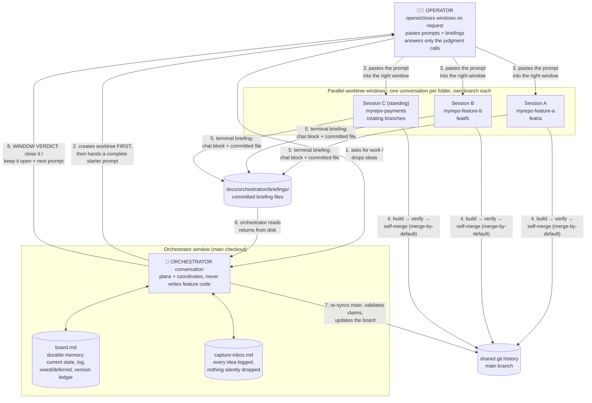
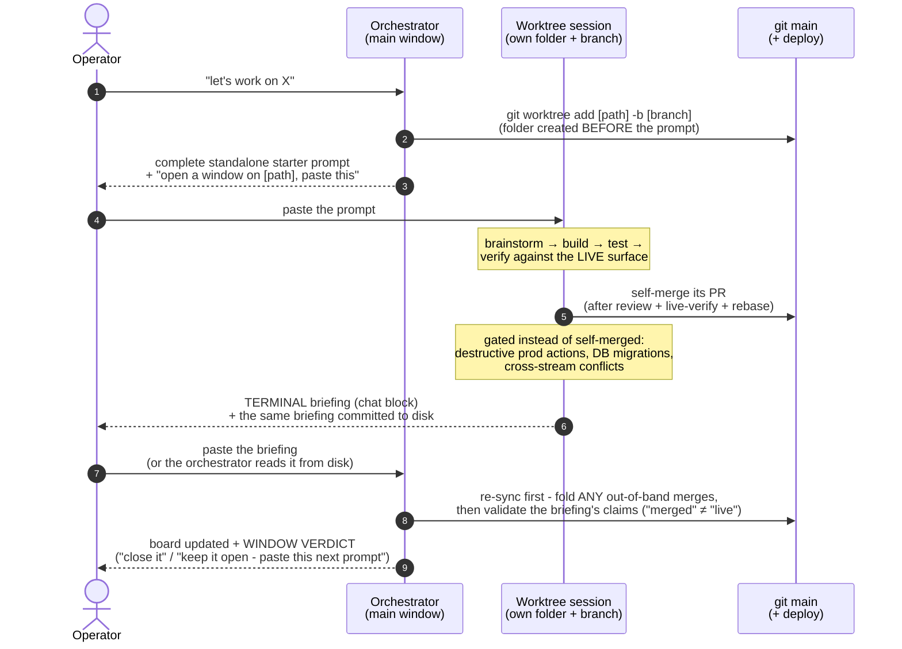

# Running Claude Code with Worktrees + an Orchestrator

*How I run many Claude Code conversations in parallel on one codebase, coordinated by a single "orchestrator" conversation. A general method, not tied to any one project - copy the prompt near the bottom into your own repo and go.*

---

## The big idea

A normal Claude Code session does one thing at a time. This setup runs **many sessions at once**, each in its own isolated copy of the repo, all coordinated by **one long-lived "orchestrator" conversation** that holds the big picture.

Think of it like a team:

- **The orchestrator** is the tech lead. It never writes feature code itself. It holds the roadmap, decides what each stream works on, writes the instructions, and keeps the master plan up to date.
- **Each worktree session** is an engineer. It owns one stream of work end-to-end (build → test → ship) and reports back when done.
- **I'm the operator.** I copy-paste prompts from the orchestrator into each worktree window, and copy the worktrees' reports back to the orchestrator. That's basically my whole job - relay messages and make the calls only I can make.

The result: 5-8 streams of work moving at the same time, without them stepping on each other.

---

## The one piece of plumbing: git worktrees

A **git worktree** is a second (third, fourth…) working copy of the same repo, each checked out to its own branch, all sharing the same underlying git history.

```
C:/dev/myrepo            ← main branch   = the ORCHESTRATOR window
C:/dev/myrepo-feature-a  ← branch feat/a = worktree session A
C:/dev/myrepo-feature-b  ← branch feat/b = worktree session B
C:/dev/myrepo-feature-c  ← branch feat/c = worktree session C
```

Why this matters: each Claude conversation gets its **own folder and branch**, so two sessions editing different things at the same time can't corrupt each other.

> **The one hard safety rule:** one Claude conversation per folder. Never run two conversations in the same working directory - branch switches in one will yank the other's files out from under it. Different worktree = safe. Same folder = corruption.

The plumbing itself is two commands:

```bash
git worktree add C:/dev/myrepo-feature-a -b feat/a   # spin one up
git worktree remove C:/dev/myrepo-feature-a          # tear it down when done
```

The orchestrator runs these itself - it creates a stream's folder *before* it ever hands me the prompt, and tears it down after merge. I never touch worktree plumbing; I just open and close windows when told. The full protocol - who does what, the safe teardown order, and one hard warning about `--force` on Windows - lives in [WINDOW-MANAGEMENT.md](WINDOW-MANAGEMENT.md).

---

## How it all fits together

*(The boxes say "Claude Code," but nothing here is Claude-specific: the windows can be any LLM coding session - Claude Code in VS Code, a terminal session, Cursor, anything that can read a prompt and work a branch. The method is the process, not the tool.)*



The same picture in plain ASCII (for terminal readers):

```
                     ┌───────────────────────────────────────┐
                     │   ORCHESTRATOR  (main branch)           │
                     │   • holds the board + the master plan   │
                     │   • writes copy-paste starter prompts   │
                     │   • triages the briefings I paste back  │
                     │   • relays dependencies between streams │
                     │   • never does feature work itself      │
                     └─────────────────┬─────────────────────┘
            starter prompt  ▲          │          ▲  briefing
            (I paste in)    │          ▼          │  (I paste back)
            ┌───────────────┼──────────┼──────────┼───────────────┐
            ▼               ▼          ▼          ▼                ▼
      ┌──────────┐    ┌──────────┐ ┌──────────┐ ┌──────────┐ ┌──────────┐
      │ worktree │    │ worktree │ │ worktree │ │ worktree │ │ worktree │
      │    A     │    │    B     │ │    C     │ │    D     │ │    E     │
      │ 1 convo  │    │ 1 convo  │ │ 1 convo  │ │ 1 convo  │ │ 1 convo  │
      └──────────┘    └──────────┘ └──────────┘ └──────────┘ └──────────┘
       own folder      own folder   own folder   own folder   own folder
       own branch      own branch   own branch   own branch   own branch
                       (all share one git history underneath)
```

---

## The loop (this is the whole workflow)

One full cycle of one stream, end to end - this is what a "day" looks like, repeated across every open window:



The same loop in plain ASCII:

```
  ME (operator)               ORCHESTRATOR                 WORKTREE SESSION
       │                           │                             │
       │ "let's work on X"         │                             │
       ├──────────────────────────►│                             │
       │                           │ writes a starter prompt      │
       │ ◄─────────────────────────┤                             │
       │  copy-paste the prompt ───┼────────────────────────────►│
       │                           │                       does the work
       │                           │                   (brainstorm → build → ship)
       │                           │                             │
       │ ◄─────────────────────────┼──────────────  emits an
       │  copy-paste the briefing  │                ORCHESTRATOR BRIEFING
       ├──────────────────────────►│                             │
       │                  triages + updates the board             │
       │ ◄─────────────────────────┤ next starter prompt          │
       │           … repeat across every worktree …               │
```

Every cycle: **prompt out → work happens → briefing back → board updated → next prompt.** I'm just the courier between windows. (And with briefings persisted to files - see #2 below - even the "briefing back" leg stops needing me: the orchestrator reads it from disk.)

---

## The building blocks

**1. Copy-paste starter prompts.** When I want to start or continue a stream, the orchestrator hands me a complete prompt I drop into that worktree's window. A good one names the worktree + branch, has a quick git pre-flight, states the goal, commits to **one clear path** (no open questions the next session will bounce back to me), lists the guardrails, and ends with a standard close-out instruction. Two disciplines that took a while to learn: every window gets its own **complete, standalone** prompt - never "use the prompt you already have, plus this one tweak" (hunting-and-editing text in another window is exactly the friction this system exists to remove). And if a prompt needs revising - even by one character - the orchestrator re-delivers the **entire** prompt as one block, plus which window to paste it into. Partial diffs across windows always go wrong.

**2. The orchestrator briefing.** Every worktree session ends by emitting a **standard 11-section "briefing"** as a copy-paste block:

1. Intent vs what actually happened
2. Current state (branch / PR / deploy)
3. What shipped + the decisive facts (and what was verified vs assumed)
4. Misses / lessons
5. Opportunities surfaced
6. Roadmap position
7. What needs me / blockers
8. Owed / deferred items + what should trigger them later
9. The session's recommendation
10. Contracts produced / consumed *(see #6 below - this is what matters most at scale)*
11. Merge target + gate *(see #10 below)*

I paste that back to the orchestrator, which triages it and tells me what's next. The full copy-paste block lives in [`orchestrator-briefing-template.md`](orchestrator-briefing-template.md). (It's just a fixed template plus the discipline that every session fills it in at close - that consistency is what makes the hand-offs clean.)

Three disciplines that hardened with use:

- **The briefing is the TERMINAL artifact.** An orchestrated session ends with the briefing and NOTHING after it - no starter prompt for its own successor. The orchestrator authors every next-session prompt, because only it holds the cross-stream map; a worktree-authored prompt bypasses that map and goes stale instantly.
- **The completeness gate (recency bias is the named failure mode).** A long session's briefing must cover the WHOLE conversation, not just the latest work-stream - one close once dropped an entire nine-project run from the same conversation because the briefing described only the final task. The fix is mechanical: re-read from the first message and enumerate every work-stream; derive the inventory from `git log` since session start (every commit and file accounted for), not from memory; if interim briefings were emitted mid-session, the final one SUPERSETS them.
- **Every pasted briefing gets a window verdict - automatically.** Any time I paste a briefing, the orchestrator's reply must tell me what to do with that window: *"close it"*, *"keep it open - paste this"*, or another named action. I never have to ask "what do I do with that window?"

**The upgrade: persist briefings to disk.** Emitting the block in chat is the floor. The better pattern: every session's close ALSO writes the same briefing - with deeper, permanent detail - to a committed file, e.g. `docs/orchestration/briefings/<date>-<slug>.md`. The chat block is the at-a-glance layer; the file is the record. Once briefings live on disk, the orchestrator reads returns straight from the repo instead of me copy-pasting in both directions - dispatch becomes one-directional. A small per-window slash command (a tiny skill any window can run: gather state, write the standardized briefing to the known path, commit) turns this into a one-word habit - and makes mid-flight status pulls cheap too.

**3. The durable board (the orchestrator's memory).** The orchestrator keeps **one markdown file on the main branch** - the state of every stream and a running log of every meaningful event. This is the key trick: because the plan lives in a file, not just in the chat, **the orchestrator conversation is disposable.** If it gets long or I restart it, a fresh conversation just reads the board and immediately becomes the orchestrator again. A shape that works:

- a **CURRENT STATE** header at the top - newest-first status lines, one per stream, so the first screen answers "where is everything right now?"
- a **dated, numbered log** of orchestrator actions below it
- the **owed/deferred registry** - each item + the trigger that should resurface it (see #9)
- a **version ledger** pinning the next free version number (see #12)

**4. Cross-stream coordination ("contracts").** When stream A builds something stream B depends on, the orchestrator carries that "contract" between them through the prompts - so B builds against the real thing instead of guessing. Shared source-of-truth docs are only ever edited on the main branch, so they never fork across worktrees.

**5. Worktrees + windows on demand - and STANDING worktrees for long arcs.** Ask for a new stream → the orchestrator runs `git worktree add`. Stream's merged → it tears the worktree down. The division of labor matters: **the orchestrator owns the folders; I only own the windows.** The cardinal rule: it creates the folder BEFORE handing me the prompt - a prompt must never tell the pasted session to create its own worktree, because I can't open a window on a folder that doesn't exist yet. And at teardown it tells me plainly: *"close that window"* or *"keep it open - next is X."*

The evolution that killed the churn: a multi-phase initiative gets **ONE standing worktree that lives until the initiative completes** - never create/retire per phase. Branches ROTATE inside it (each new session branches fresh off the live main from within the same folder); the folder and its bootstrap (env files, installed dependencies) persist. Re-checking out thousands of files and re-installing dependencies every phase was pure waste, and so was the window churn. Ephemeral worktrees stay correct for genuinely one-shot streams - the dispatch question is *"will this thread need more than ~2 sessions?"* If yes or unsure, standing. (Serial reuse never violates one-conversation-per-folder - that law is about CONCURRENT conversations.) Full protocol (including the Windows file-lock gotcha and the `--force` warning): [WINDOW-MANAGEMENT.md](WINDOW-MANAGEMENT.md).

---

## The building blocks that make it scale past ~3 streams

The five above get you started. These five are what makes the difference between "parallel" and "parallel chaos" once 5-8 streams run at once.

**6. Contracts - the cross-stream glue.** The first thing that breaks at scale: stream B needs something stream A is building (a new database column, a status value, a shared string both sides parse). Don't let it live in anyone's memory. When a stream produces something another will consume, it writes a **named contract** - exact names and values, copy-paste-ready - in its briefing. The orchestrator lifts it *verbatim* into the consumer's prompt, so B builds against the real thing instead of guessing. Almost every cross-stream bug traces back to a dependency described in prose instead of pinned exactly.

**7. One owner per shared repo.** When several streams need to touch the *same* repo (e.g. a frontend everyone depends on), funnel ALL changes to it through ONE designated worktree. A stream that needs a change there **emits a contract** for the owning worktree instead of editing the repo itself. This stops two streams silently making conflicting edits. (On the day this section was written, two streams were about to make the same frontend change - this rule is why they didn't.)

**8. The orchestrator validates before it relays.** A briefing is a *claim*, not a fact. Before acting on anything that reshapes priorities or crosses streams, the orchestrator re-checks it against the actual code/DB - it never rubber-stamps, not even its own earlier decisions. The briefing format asks each session to flag what it **verified vs assumed**, so the orchestrator knows exactly what to re-check. And before relaying any *prompt*, it runs a concrete checklist that keeps catching real defects:

- **Version** - does the prompt's ship version match the board's next-free slot?
- **Paths** - does every file path the prompt references actually exist on disk / on the target branch?
- **Contracts** - do any contracts the prompt consumes match the live code exactly?

If anything changes, re-deliver the whole prompt (see #1) - never a partial correction.

**9. An owed/deferred registry + a "what's blocked on what" view.** Every briefing lists owed/deferred items + the trigger that should resurface each. Collect those in ONE place on the board, alongside a simple gate view (which stream is blocked on which). Otherwise a deferred item with a future trigger quietly evaporates and you lose the dependency graph.

**10. Merge-by-default.** Early on, the orchestrator gated every merge - which made it the bottleneck. The evolved protocol: **worktrees merge their own PRs** once they've (a) passed review, (b) verified the change live, and (c) rebased onto the live main branch first. The orchestrator's job moves post-merge: validate the briefing, confirm the change is genuinely live, record it on the board. Three carve-outs stay gated - the worktree surfaces these instead of self-merging: **irreversible or destructive production actions**, **database migrations**, and **any cross-stream conflict** the orchestrator's validation turns up. And nobody merges something another stream still needs open.

---

## The habits that keep it honest at full speed

Three more that only start to matter once merges, versions, and ideas are all flying at once.

**11. Re-sync before every triage.** Under merge-by-default, streams merge on their own schedule - out-of-band from the briefings. So before triaging ANY briefing (or idea), the orchestrator fetches and inspects the main branch first: new commits are merge events to fold into the board *even if no briefing ever arrives for them*. Corollary: **"merged" ≠ "live", and a handoff can be stale.** Before dispatching a task, validate it's still outstanding - another stream may already have shipped it.

**12. The version-tag race guard.** With several streams shipping near-simultaneously, two of them will eventually try to claim the same version number. Before any bump or tag: **list the existing tags AND re-read the version file from disk** - never tag from a version remembered in context (the stream may have branched when an older version was tip). The board's version ledger pins `NEXT FREE = vX.Y.Z` so every prompt carries the right slot.

**13. The capture inbox.** The orchestrator window is where I already live, so it doubles as my **capture inbox**: any idea, note, or request I drop mid-conversation gets logged to a durable file (e.g. `docs/orchestration/capture-inbox.md`) with an explicit disposition - **immediate** (spin or feed a stream now), **future** (held, with the trigger that should resurface it), **quick** (filed straight to its home), or **cross-cutting** (folded into the board/docs). The rule is simply: nothing is silently dropped. Chat is ephemeral; the inbox file is not.

---

## Going multi-repo

Two patterns for when the method outgrows a single repo:

**A meta-orchestrator across several repos.** One orchestrator can coordinate streams across multiple repos: it holds the cross-repo map, creates worktrees in each repo, relays contracts and findings between them, and stores the cross-cutting knowledge. Each repo still keeps its own board/docs and its own worktree discipline - the meta-orchestrator plans and relays; it doesn't edit the other repos' files directly.

**One-directional information walls.** Sometimes one orchestrator's world must not be visible to another (separate businesses, separate teams, client confidentiality). The pattern: coordinate ONLY through **self-contained relay messages** - each message carries everything the receiving side needs and never references anything from the hidden side. One meta-orchestrator may see everything; each walled orchestrator sees only its own world. When drafting anything that crosses the wall, the test is: *could the receiving side infer the hidden side's existence from this message?* If yes, rewrite it.

**The relay protocol (the mature version).** Once two orchestrators run daily, clipboard relaying breaks - the operator becomes the single point of failure for cross-domain dependencies. The evolved system: relays are **committed FILES in known inbound/outbound directories**, each self-contained with a standard header (`relay-id`, `handles`, `action-owner`, `expects-reply`); each orchestrator **polls the other's outbox on every re-sync** (that poll is the delivery guarantee - an operator ping accelerates but is never load-bearing); acks carry a **terminator** so two polite orchestrators don't ack each other forever; and a relay that NAMES an action does not ASSIGN it - execution transfers only via an explicit `action-owner`. The standing routing rule that fell out of it: **work executable by the other orchestrator's domain relays to it the same turn it surfaces - the operator's queue holds only genuinely-human judgment.** Full spec: [RELAY-PROTOCOL.md](RELAY-PROTOCOL.md).

**Running unattended.** The orchestrator can also run alone for hours - overnight, over a weekend - under hard rails (nothing sent, nothing merged, nothing spent; code fixes held as draft PRs; one ranked morning report at the end). The field-tested pattern, phases, and the self-inflicted lessons: [OVERNIGHT-AUTOPILOT.md](OVERNIGHT-AUTOPILOT.md).

---

## The generic prompt (paste this into your own Claude Code to set it up)

```
You are my ORCHESTRATOR for this repo. I run multiple Claude Code conversations at once,
each in its own git worktree, working on separate streams of work in parallel. You hold the
big picture and coordinate them. You do NOT write feature code yourself (that would collide
with the worktrees) - you plan, you write the prompts I paste into each worktree, you process
what they report back, and you keep one durable "board" file up to date.

Your responsibilities:

1. DURABLE BOARD. Maintain a single markdown file on the main branch (e.g.
   docs/orchestration/board.md) as your memory, shaped as: a CURRENT-STATE header at the top
   (newest-first, one status line per stream), a dated numbered log of your actions below it,
   an owed/deferred registry (each item + the trigger that should resurface it), a simple
   "what's blocked on what" gate view, and a version ledger pinning the next free version
   number. This file is the source of truth: if this conversation restarts, a fresh one reads
   the board and becomes the orchestrator.

2. STARTER PROMPTS. When I start or continue a stream, give me a complete copy-paste starter
   prompt for that window. It must: name the worktree + branch, include a short git pre-flight,
   state the goal, commit to ONE clear path (never bury a decision inside it for the next
   session to bounce back to me), paste in any contracts it depends on (see #5), list the
   constraints, and end with the close-out instruction (emit + persist the briefing, see #3).
   Every window gets its OWN complete standalone prompt - never "reuse the prompt you have
   plus a tweak" - and any revision, however small, re-delivers the ENTIRE prompt.

3. BRIEFINGS - IN CHAT AND ON DISK, TERMINAL, AND COMPLETE. Tell every worktree session to
   END by (a) emitting the structured orchestrator briefing as a copy-paste block: (1) intent
   vs what happened, (2) state (branch/PR/deploy), (3) what shipped + key facts + what it
   VERIFIED vs ASSUMED, (4) misses/lessons, (5) opportunities, (6) roadmap position, (7) what
   needs me / blockers, (8) owed/deferred + triggers, (9) recommendation, (10) CONTRACTS
   produced/consumed, (11) merge target + gate - AND (b) writing the same briefing with
   fuller detail to a committed file at docs/orchestration/briefings/<date>-<slug>.md.
   The briefing is the session's TERMINAL artifact: nothing after it, and the session never
   authors its own successor's starter prompt - YOU author every next prompt. The briefing
   must cover the WHOLE conversation, not just the latest task: enumerate every work-stream
   from the first message, derive the inventory from git log since session start, and
   superset any interim briefings. Read returned briefings from disk when they exist;
   triage, update the board, hand me the next prompt. EVERY briefing I paste gets an
   explicit window verdict in your reply: "close it" / "keep it open - paste this" / another
   named action. Never leave me guessing what to do with a window.

4. WORKTREES + WINDOWS. You own the worktree folders; I only open/close editor windows when
   you tell me to. CARDINAL RULE: create the worktree (git worktree add <path> -b <branch>)
   BEFORE handing me a prompt for it - never write a prompt that tells the pasted session to
   create its own worktree. One Claude conversation per folder, always. A multi-phase
   initiative gets ONE STANDING worktree that persists across its sessions - branches rotate
   inside it (new branch off the live main each phase, from within the folder); create/retire
   per phase is churn. Ephemeral worktrees are for one-shot streams ("more than ~2
   sessions?" → standing). At teardown: triage the briefing, confirm the branch is on the
   remote, plain `git worktree remove` - NEVER --force on a locked or heavy worktree (a
   forced, partially-failed delete can damage the shared main checkout) - then tell me
   plainly "close that window" or "keep it open - next is X". Leftover locked folders are
   harmless; leave them.

5. CONTRACTS + ONE OWNER PER SHARED SURFACE. When one worktree produces something another
   depends on, capture it as a NAMED contract (exact names/values, copy-paste-ready) and
   paste it verbatim into the consumer's prompt - don't paraphrase. Funnel ALL changes to a
   shared repo or surface through ONE designated worktree; the others emit contracts for it
   instead of editing it. Edit shared source-of-truth docs ONLY on the main branch.

6. VALIDATE BEFORE YOU RELAY. A briefing is a claim, not a fact. Re-sync first: git fetch +
   inspect main - streams merge out-of-band, so fold new commits into the board even when no
   briefing arrived for them. Then before relaying anything: confirm the prompt's version
   matches the board's next-free slot (list tags + re-read the version file - never trust a
   version remembered in context), confirm every file path it references exists, confirm
   consumed contracts match the live code, and confirm the task is still outstanding
   ("merged" ≠ "live"; another stream may already have shipped it).

7. MERGE-BY-DEFAULT. Streams self-merge their own PRs after review + live verification +
   rebasing onto the live main branch. Your job is post-merge: validate, confirm it's
   genuinely live, record it on the board. Keep gated (surfaced to me, not self-merged):
   irreversible/destructive production actions, database migrations, and cross-stream
   conflicts your validation surfaces. Never merge what another stream still needs open.

8. CAPTURE INBOX. I will drop ideas, notes, and requests in this window at any time. Log
   every one to a durable file (e.g. docs/orchestration/capture-inbox.md) with a disposition:
   immediate / future-held-with-trigger / quick-filed / cross-cutting. Never silently drop
   anything.

9. ASK FIRST, THEN PROMPT. If a decision is genuinely mine, ask me one clear question first;
   don't make the next session ask it back through me.

Start by reading the repo, then propose how to split the current work into parallel worktree
streams. Maintain the board from here on. When I say "go," create the worktrees and hand me
the starter prompts.
```

---

## Why it works

- **Parallelism without chaos.** Worktrees give isolation; the orchestrator gives coordination. You get the speed of many sessions without them corrupting each other.
- **The plan outlives the chat.** Because the board, the briefings, and the master docs live in files on the main branch, no context is lost when a conversation ends - you can always reboot the orchestrator from the board.
- **Low operator overhead.** Day to day, my job is mostly copy-pasting prompts out, opening and closing windows when told, and answering the occasional "this one's your call" question. The system holds the complexity, not me.

**Tips:** keep the orchestrator out of feature work (it only edits shared docs on main); enforce one-conversation-per-folder; let the orchestrator own the folders while you own the windows (worktree created *before* the prompt, always); make every starter prompt complete, standalone, and committed to a single path; make every session end with the briefing - in chat and on disk; and validate before relaying anything. Those habits are what make it run smoothly.

---

## Files in this repo

- **[README.md](README.md)** - this playbook (the method, the diagrams, the orchestrator prompt).
- **[orchestrator-briefing-template.md](orchestrator-briefing-template.md)** - the full copy-paste briefing block every worktree session emits at close, plus the completeness gate.
- **[WINDOW-MANAGEMENT.md](WINDOW-MANAGEMENT.md)** - who owns worktree folders vs editor windows, standing vs ephemeral worktrees + branch rotation, window verdicts, the safe teardown sequence, and the Windows file-lock / `--force` warning.
- **[RELAY-PROTOCOL.md](RELAY-PROTOCOL.md)** - file-based coordination between TWO (or more) orchestrators across an information wall: relay headers, polling as the delivery guarantee, ack terminators, and the executor rule.
- **[OVERNIGHT-AUTOPILOT.md](OVERNIGHT-AUTOPILOT.md)** - running the orchestrator unattended for hours: the rails, the phase plan, evidence-chain investigation discipline, and the morning report.

## License

[MIT](LICENSE). Use it, fork it, adapt it.
