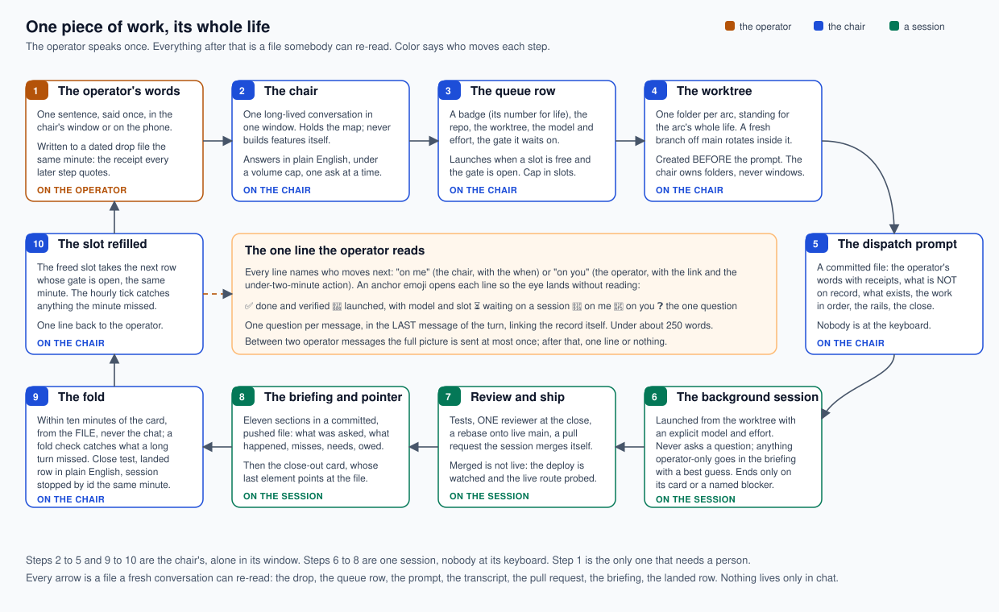

# ai-orchestrator

*One long-lived "chair" conversation dispatches many agentic coding sessions in parallel, each in its own git worktree, each launched with an explicit model and effort, each ending in a committed briefing file the chair folds back from disk. Written for any agentic coding tool: Claude Code, Codex, Gemini CLI, Cursor, OpenCode, Hermes, OpenClaw, or a local model through Ollama. A method, not a product. By Rob Brautigam.*

---

## The picture

<p align="center">
  
</p>

One piece of work, its whole life, in ten stations:

1. **The operator's words.** Said once, written to a dated file the same minute. That file is the receipt every later step quotes.
2. **The chair.** One conversation in one window. It holds the map, writes every prompt, folds every landing, and never builds a feature itself.
3. **The queue row.** A badge, a repo, a worktree, a model and effort, a gate. It launches when a slot is free and the gate is open.
4. **The worktree.** One folder per arc, standing for the arc's whole life; a fresh branch rotates inside it. Created before the prompt, never by the session.
5. **The dispatch prompt.** A committed file: the operator's words with receipts, what is not on record, what exists, the work in order, the rails, the close.
6. **The background session.** Launched from the worktree with the model and effort spelled out. Nobody is at its keyboard, so it never asks a question.
7. **Review and ship.** Tests, one reviewer at the close, a rebase onto live main, a pull request the session merges itself, a deploy watched and a live route probed.
8. **The briefing file and the pointer block.** Eleven sections in a pushed file; then a close-out card whose last element points at the file.
9. **The fold.** The chair reads the file, never the chat; runs the close test; writes one landed row in plain English; stops the session by id the same minute.
10. **The slot refilled.** The next row whose gate is open launches the same minute. One line goes back to the operator, and that line says who moves next.

Everything between station 1 and station 10 is a file a fresh conversation can re-read. Nothing lives only in chat.

---

## Why this exists

A single coding agent does one thing at a time and asks you questions while it does it. The July 2026 version of this repository ran five to eight of them at once by having a human copy prompts out of one window and paste briefings back into it. It worked, and it made the human the bottleneck: every session waited hours for a paste that took seconds.

Version 2 removes the human from the loop everywhere a file can stand in for a paste:

- The chair launches sessions itself, in the background, from a queue with a cap.
- A session ends with a file, and the chair folds from the file. There is no paste.
- The operator is involved through exactly one surface: a short message that says what landed, what is running, and the one question that is genuinely theirs.

The cost of running many sessions is real and it is the reason half the chapters exist. A session launched without an explicit model inherits whatever the operator last selected, which is usually the most expensive model on the account. A swarm of fifty helper agents on that model burned a whole day's allowance in one call. A background session that stopped before its close-out card sat idle for 41 minutes waiting for nobody. Every rule below was written after something like that happened and was measured.

---

## The model, in chapters

Each chapter is its own file. Read them in order the first time; after that, each stands alone.

| # | Chapter | What it settles |
|---|---|---|
| 1 | [The chair and its one window](docs/01-the-chair.md) | What the chair does and never does; the boot from files; the durable board; the capture inbox |
| 2 | [Arcs and standing worktrees](docs/02-arcs-and-standing-worktrees.md) | One folder per arc for the arc's life; branch rotation; the cardinal rule (folder before prompt); the teardown order; the force warning |
| 3 | [The dispatch queue](docs/03-the-dispatch-queue.md) | Slots, the cap, gates, badges; the running, waiting and landed tables; the same-minute refill; the [generic example file](templates/QUEUE.md) |
| 4 | [The dispatch prompt](docs/04-the-dispatch-prompt.md) | The header (the operator's words with receipts; what is NOT on record; what exists), the work, the rails, the close; the [template](templates/dispatch-prompt.md) |
| 5 | [The background session and the close-out card](docs/05-the-background-session-and-the-close-out-card.md) | Nobody at the keyboard; never a question; the two ways a session may end; the card's seven sections; the [card template](templates/close-out-card.md) |
| 6 | [The briefing file and the pointer block](docs/06-the-briefing-file-and-the-pointer-block.md) | The file is the briefing, the chat block is a pointer; the eleven sections; the completeness gate; the [briefing template](templates/briefing.md) and the [pointer block](templates/pointer-block.md) |
| 7 | [Folding from files](docs/07-folding-from-files.md) | The close test; the read ladder when a file is unreachable; the fold; the stop by id; merged is not live |
| 8 | [The hourly tick](docs/08-the-hourly-tick.md) | The chair's clock: its twelve steps, in order, every hour, whether or not anything landed |
| 9 | [The cost rules](docs/09-the-cost-rules.md) | Explicit model and effort on every launch; a cap in slots; a design session counts two; never a long-context variant in the background; the swarm law; the two incidents behind it |
| 10 | [Process hygiene](docs/10-process-hygiene.md) | Kill what you start, by id; never by image name; never elevate; never a window on the operator's screen; the census |
| 11 | [The communication standard](docs/11-the-communication-standard.md) | How the chair talks to the operator: plain English with jargon paired to its meaning, the volume cap, one ask per message, real lists, the on-me and on-you law, the anchor emoji set, every ask links the record, the rolling top ten, one rolling picture between two messages |
| 12 | [Going multi-repo](docs/12-going-multi-repo.md) | A chair across several repositories; one-directional information walls; the file relay protocol; running unattended |

Two documents from July are kept where they still hold, revised where the model moved: [RELAY-PROTOCOL.md](RELAY-PROTOCOL.md) (two chairs coordinating through committed files across a confidentiality wall) and [OVERNIGHT-AUTOPILOT.md](OVERNIGHT-AUTOPILOT.md) (the chair running alone for hours under hard rails). What changed since July, and why, is in [CHANGELOG.md](CHANGELOG.md).

---

## Adapters: the same model on your tool

The model is tool-agnostic. What differs per tool is four commands: start a session in the background with a model and effort, list and stop sessions, put a session in its own worktree, and run a helper agent inside a session. Each adapter is a short file that maps those four to the tool's own flags, with **"not verified"** wherever the tool's documentation did not say. Every adapter was checked against the tool's own documentation on the date at the top of the file.

| Tool | Adapter | Background session | Worktree | Helper agents |
|---|---|---|---|---|
| Claude Code | [adapters/claude-code.md](adapters/claude-code.md) | `claude --bg --name <arc> --model <alias> --effort <level> "<prompt>"`; `claude agents --json`; `claude stop <id>` | `git worktree add` by the chair, or `claude -w <name>` | built in |
| Codex | [adapters/codex.md](adapters/codex.md) | `codex exec` in a process you supervise; `--json`; `codex exec resume` | `/worktree` in the TUI; `git worktree add` by the chair | built in since current releases; custom agents in `.codex/agents/*.toml` |
| Gemini CLI | [adapters/gemini-cli.md](adapters/gemini-cli.md) | `gemini -p "<prompt>" --output-format stream-json` in a process you supervise | `git worktree add` by the chair | built in; custom agents in `.gemini/agents/*.md` |
| Cursor | [adapters/cursor.md](adapters/cursor.md) | `agent -p "<prompt>" --model <m> --output-format stream-json`; the `&` prefix hands off to a cloud agent | `agent -w <name> --worktree-base <branch>` | not verified |
| OpenCode | [adapters/opencode.md](adapters/opencode.md) | `opencode run --model <provider/model> --agent <name> --format json "<prompt>"`; `opencode serve` plus `--attach` | `git worktree add` by the chair | built in; agents in `.opencode/agents/*.md` |
| Hermes | [adapters/hermes.md](adapters/hermes.md) | `hermes chat --oneshot -q "<prompt>" --model <m> --format stream-json` | `hermes -w` | `delegate_task`, up to ten in parallel by default |
| OpenClaw | [adapters/openclaw.md](adapters/openclaw.md) | `openclaw agent exec --message-file <prompt> --cwd <worktree> --model <provider/model> --json` | `sessions_spawn` takes `worktree`, `worktreeName`, `worktreeBaseRef` | `sessions_spawn`, with depth caps |
| A local model through Ollama | [adapters/ollama.md](adapters/ollama.md) | `ollama serve`, then any tool above pointed at `http://localhost:11434/v1`; `ollama launch <tool>` | the tool's own | the tool's own |

The rule that does not change per tool: **every launch names its model and its effort, in the command and in the chat line that reports it.** An unspecified model is the most expensive one.

---

## Quick start

1. Copy [`templates/`](templates/) into your repository under `docs/orchestration/` and rename nothing else.
2. Open one conversation in your tool in the repository's main checkout. Paste [the chair's starter prompt](docs/01-the-chair.md#the-chairs-starter-prompt).
3. Tell it what you want in one sentence. It writes the drop file, the queue row, the worktree and the dispatch prompt, and launches the session with the model and effort it names in its reply.
4. Read the one line it sends you when the session lands. Answer the one question, if there is one, at the link it gives you.

Install the `/orchestrator-brief` command so any session can write its briefing file on demand: copy [`skills/orchestrator-brief/`](skills/orchestrator-brief/) to your tool's skills folder (`~/.claude/skills/` on Claude Code; see the adapters for the others).

---

## Checking the tree before you publish

`scripts/wall-check.py` scans every tracked file for a list of words that must not appear (names, clients, domains, identifiers) and for generic secret shapes (keys, emails, private paths). The list of words lives outside the repository so the check itself leaks nothing; a placeholder list is in [`scripts/wall-list.example.txt`](scripts/wall-list.example.txt).

```
python scripts/wall-check.py --list ~/wall-list.txt
```

Exit 0 is zero hits. This repository's own publish gate is that command at zero.

---

## Files in this repository

- **[README.md](README.md)**: this page.
- **[docs/](docs/)**: the twelve chapters and the picture.
- **[templates/](templates/)**: the queue file, the dispatch prompt, the close-out card, the briefing, the pointer block. Copy them; do not link to them.
- **[adapters/](adapters/)**: one short file per tool.
- **[skills/orchestrator-brief/](skills/orchestrator-brief/SKILL.md)**: the on-demand briefing command.
- **[scripts/wall-check.py](scripts/wall-check.py)**: the publish gate.
- **[RELAY-PROTOCOL.md](RELAY-PROTOCOL.md)** and **[OVERNIGHT-AUTOPILOT.md](OVERNIGHT-AUTOPILOT.md)**: kept from July, revised.
- **[CHANGELOG.md](CHANGELOG.md)**: what moved since July and why.

## License

[MIT](LICENSE). Use it, fork it, adapt it.
