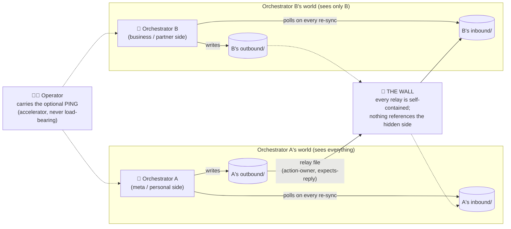

# Cross-Orchestrator Relay Protocol

*How two (or more) orchestrators coordinate across an information wall - through committed relay FILES, not through the operator's clipboard. This is the pattern that emerged once the method grew past one orchestrator: a personal-side orchestrator and a business-side orchestrator that must cooperate without seeing into each other's worlds.*

---

## The problem this solves

Two orchestrators, two repos, one wall:

- Orchestrator A (say, your personal meta-orchestrator) is allowed to see everything.
- Orchestrator B (say, a business with partners, clients, or confidentiality) must never learn about A's other world - and A must never leak B's internals into its own docs.
- Before this protocol, every cross-orchestrator message traveled by the operator copy-pasting between windows. The operator became the single point of failure: forget one paste and a dependency silently dies.

The fix: **relays are committed files in a known directory, and each orchestrator polls the other's outbox on every re-sync.** The operator stops being the delivery mechanism and goes back to being the decision-maker.

## The picture



## The plumbing

Each side keeps two directories in its own repo (the wall-side repo hosts both, or each repo hosts its own pair - what matters is that both orchestrators can read the same folders on disk):

```
docs/orchestration/relays/
  inbound/    <- relays ADDRESSED TO this orchestrator (the other side writes here)
  outbound/   <- relays this orchestrator SENDS (the other side polls here)
```

A relay is one markdown file, named `<date>-<from>-<slug>.md`.

## The relay header (every relay carries all of these)

```
relay-id: 2026-07-23-a-to-b-example-slug
from: <which orchestrator, which repo/branch>
sent: <date>
handles: <the relay-id(s) this responds to, or "new">
action-owner: <who EXECUTES: a | b | operator | none>
needs-operator: <what only the human can decide, or "none">
expects-reply: <yes: what | no>
```

`action-owner` is the load-bearing field - see "Naming is not assigning" below.

## The five rules

**1. Every relay is SELF-CONTAINED.** The receiving side must be able to act on the file alone: full context, exact names/values/paths on ITS side of the wall, verification steps. The wall test before sending: *could the receiver infer the hidden world's existence from this message?* If yes, rewrite. Never reference the hidden side's repos, projects, or people.

**2. Polling is the delivery guarantee; the operator ping is an accelerator.** Each orchestrator polls the other's `outbound/` at every re-sync (the same moment it fetches main). That poll is the guarantee - a relay is never allowed to depend on a human noticing it. ON TOP of that, every send comes with a **copy-paste operator ping**: one short message the operator can drop into the destination window to make it read the relay NOW instead of at its next re-sync. Two hard sub-rules learned the expensive way:

- **The sender must confirm the send to the operator in the same reply, WITH the ping.** Silent relays (sent but never mentioned) leave the operator with a false picture of what is in flight.
- **The ping is never load-bearing.** If the operator never pastes it, the poll still delivers. A skipped ping breaks nothing; the human is never on-call for the machine.

**3. Ack discipline + the ack terminator.** The receiver acknowledges a relay by filing it (what it accepted, where it routed each item) in ONE ack relay - and an ack that says `expects-reply: no` is TERMINAL. Nobody acks the ack. Without the terminator, two conscientious orchestrators will politely ack each other forever.

**4. Naming is not assigning (the executor rule).** A relay that NAMES an action on the other side's domain is informational by default - the receiving orchestrator owns whether/how to execute it. Execution transfers ONLY when the relay explicitly sets `action-owner` to the other side, or the operator directs it in that window. The sender stays **track-only**: it may remind the operator the item exists; it never stages, drafts, or pre-executes the other domain's work. Ambiguity resolves to track-only plus one clarifying relay.

**5. Route work to the domain owner by default - never queue it on the operator.** The standing failure mode: orchestrator A discovers something only B's domain can execute, and parks it on the operator's to-do list ("tell B to..."). The fix that stuck: **anything executable by the other orchestrator relays to it in the same turn it surfaces.** The operator's queue holds only what is genuinely human: pricing, brand, people judgment, personal-voice messages, irreversible approvals. Everything else flows orchestrator-to-orchestrator.

## Optional hardening: the prompt hook

A small prompt-submit hook in each repo (whatever your Claude Code setup supports) that checks the inbound directory for unread relays whenever the operator sends ANY message, and injects a one-line flag if something is waiting. That gives three delivery layers: poll-on-resync (guarantee), operator ping (accelerator), hook (catch-all). In live use, the hook has caught relays the same minute the operator typed anything at all.

## What a healthy exchange looks like

1. A discovers a broken data feed that only B's domain can fix. Same turn: A writes `outbound/<date>-a-feed-dead.md` (self-contained evidence, `action-owner: b`), confirms the send to the operator, hands over the ping.
2. B's next re-sync polls the folder, reads the relay, files it into its own board, dispatches its own fix stream, and writes ONE ack (`expects-reply: no`) noting where each item routed.
3. A's next re-sync reads the ack, updates its waiting-for register, done. If B's fix later produces facts A should know, that's a NEW relay, not a reply chain.

One real exchange worth copying: A relayed "your sync is dead, hiding a 95% collapse." B did not take the claim at face value - it re-verified against three independent sources and relayed back a corrected verdict (the sync was alive; the decline was real but half the size, and behavioral, not technical). **A briefing is a claim; a relay is also a claim.** The receiving orchestrator validates before acting - in both directions.

## Why it works

- The operator is out of the delivery path (and back in the judgment path).
- The wall holds mechanically: relays are the ONLY crossing, and each one passes the wall test.
- Everything is on disk and committed - a fresh orchestrator conversation on either side reconstructs all in-flight cross-domain state from the two folders.
